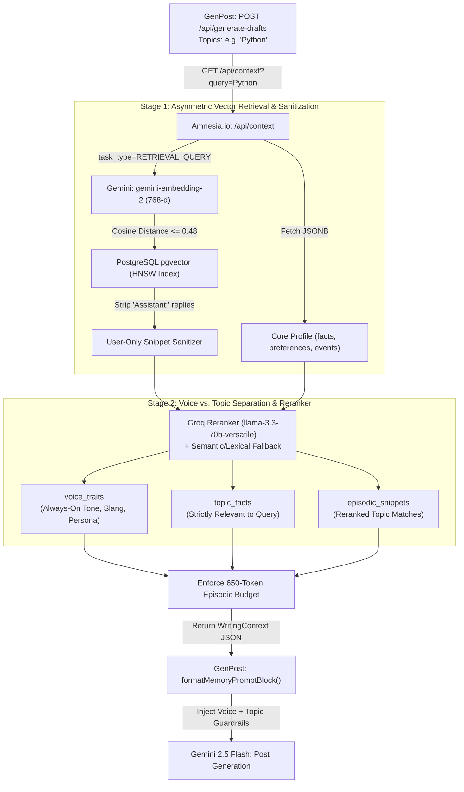

# How the Two-Stage RAG System Works (Amnesia.io + GenPost)

This document explains the **Two-Stage Retrieval-Augmented Generation (RAG) & Context Reranking** pipeline that powers personalized content generation between **Amnesia.io** (the memory engine) and **GenPost** (the social post generator).

---

## 🎯 1. Problem It Solves

In a naive memory system, asking an LLM to generate a social media post about a specific topic (e.g., `"Python"`) while injecting the user's entire memory profile causes **context bleeding / topic pollution**:
1. **Unfiltered Core Profile Injection**: A flat profile containing all user preferences (e.g., *"My favourite food is jollof rice"*, *"Loves green tea"*) gets dumped into a tech post prompt, causing the generator LLM to awkwardly shoehorn food references into a Python post.
2. **Top-K Padding Without a Distance Cutoff**: Standard `LIMIT 8` vector queries return 8 rows even if the user only has 1 memory about Python — filling the remaining 7 slots with completely unrelated memories.
3. **Assistant Turn Pollution**: Raw chat memories (`"User: ...\nAssistant: ..."`) include the AI assistant's own text, which downstream writing tools mistake for the user's writing style.
4. **Conflating "How the User Speaks" with "What the User Likes"**: Voice/style traits (tone, slang, dialect, persona) should apply to *every* post, whereas domain facts and preferences (tech vs. food vs. fitness) must only be injected when topically relevant.

---

## 🏗️ 2. End-to-End Architecture



---

## 🔍 3. Deep Dive: Stage-by-Stage Pipeline

### Step 1: Category-Aware Ingestion & Storage
Memories and profile facts are tagged at write time so the retrieval engine knows what kind of information each record represents:

- **Asymmetric Document Embeddings** ([`gemini_client.py:get_embedding`](file:///c:/Users/HP/Documents/Projects/amnesia.io/backend/app/gemini_client.py#L42-L82)):
  Every stored memory is embedded via `gemini-embedding-2` (768 dimensions) using `task_type="RETRIEVAL_DOCUMENT"`, paired with transient SSL/connection retry logic.
- **Episodic Memory Types** ([`models.py:EpisodicMemory`](file:///c:/Users/HP/Documents/Projects/amnesia.io/backend/app/models.py#L28-L41)):
  Each row in `episodic_memories` carries a `memory_type`:
  - `"chat_turn"`: Raw conversational turns saved by Path A ([`background_workers.py:execute_path_a_turn_embedding`](file:///c:/Users/HP/Documents/Projects/amnesia.io/backend/app/background_workers.py#L25-L69)).
  - `"event"`: Consolidated life/session events extracted at session end by Path B ([`background_workers.py:execute_path_b_session_extraction`](file:///c:/Users/HP/Documents/Projects/amnesia.io/backend/app/background_workers.py#L71-L238)).
  - `"post_sample"`: Approved posts or writing samples ingested via `POST /api/memory/ingest` ([`integration_routes.py:ingest_memory`](file:///c:/Users/HP/Documents/Projects/amnesia.io/backend/app/integration_routes.py#L37-L60)).
- **Core Profile Categories** ([`memory_service.py:merge_profile_facts`](file:///c:/Users/HP/Documents/Projects/amnesia.io/backend/app/memory_service.py#L536-L586)):
  Items stored in `core_profiles.profile` (`facts`, `preferences`, `events`) are tagged with a `category`:
  - `"voice"`: Tone, slang, dialect, and writing quirks (e.g., pushed from GenPost's Settings voice field).
  - `"identity"`: Occupation, role, age range, or bio.
  - `"topic"`: Domain-specific interests, tech stack preferences, foods, or hobbies.

---

### Step 2: Stage 1 Retrieval — Asymmetric Querying & Distance Cutoff
When GenPost calls `GET /api/context?query=<topics>&limit=8` ([`memory_service.py:get_writing_context`](file:///c:/Users/HP/Documents/Projects/amnesia.io/backend/app/memory_service.py#L418-L506)):

1. **Query Embedding (`RETRIEVAL_QUERY`)**:
   The target `query` (e.g., `"Python"`) is embedded using `task_type="RETRIEVAL_QUERY"`, which optimizes the vector representation for asymmetric short-query-to-long-document matching.
2. **Cosine Distance Cutoff (`RAG_MAX_COSINE_DISTANCE`)**:
   `pgvector` computes `EpisodicMemory.embedding.cosine_distance(query_embedding)` using the HNSW index and filters out any row with `distance > 0.48`:
   ```python
   distance_expr = EpisodicMemory.embedding.cosine_distance(query_embedding)
   stmt = (
       select(EpisodicMemory, distance_expr.label("distance"))
       .where(EpisodicMemory.user_id == user_id)
       .where(distance_expr <= settings.rag_max_cosine_distance)
       .order_by(distance_expr)
       .limit(limit)
   )
   ```
   If the user has 0 or 1 memory related to `"Python"`, only that memory is returned — unrelated memories (e.g., about food or sports) are rejected at the database level instead of padding up to `limit=8`.
3. **Assistant Turn Stripping** ([`memory_service.py:_clean_memory_for_writing`](file:///c:/Users/HP/Documents/Projects/amnesia.io/backend/app/memory_service.py#L63-L75)):
   For any retrieved `"chat_turn"` memory formatted as `"User: ...\nAssistant: ..."`, the `"Assistant: ..."` portion is stripped out so the AI assistant's own words are never passed to GenPost as the user's voice.

---

### Step 3: Stage 2 Reranking — Voice vs. Topic Separation
Even after `pgvector` filters episodic memories, the user's `CoreProfile` still contains all of their permanent facts and preferences across every domain. Stage 2 ([`memory_service.py:_filter_and_rerank_writing_context`](file:///c:/Users/HP/Documents/Projects/amnesia.io/backend/app/memory_service.py#L297-L415)) splits and filters both the `CoreProfile` and the Stage 1 candidate snippets:

#### Layer A: Fast Groq LLM Context Filter (`llama-3.3-70b-versatile`)
A deterministic (`temperature=0.0`) JSON pass classifies and sanitizes the retrieved items against `query`:
- **`voice_traits`**: Extracts **only** communication style, tone, slang, dialect, or general demographic/professional persona (e.g., `"Nigerian"`, `"uses pidgin sometimes"`, `"casual and hype tone"`). If a single profile entry mixes persona with an unrelated hobby/food (e.g., *"19yo student who loves eating pizza"* when `query="Python"`), the off-topic clause is stripped so only the persona remains.
- **`topic_facts`**: Retains **only** profile facts, preferences, and events whose subject matter directly matches `query`. When `query="Python"`, Python/FastAPI facts are kept while food/drink preferences are discarded. When `query="Food & Cooking"`, food/drink preferences are kept while coding facts are discarded.
- **`episodic_snippets`**: Reranks and filters the Stage 1 candidate snippets so only snippets relevant to `query` survive.

#### Layer B: Deterministic Semantic + Lexical Fallback
If Groq is unconfigured or unreachable, Stage 2 automatically falls back to a local two-part filter:
- Detects voice/tone items via `category == "voice"` and [`VOICE_KEYWORDS`](file:///c:/Users/HP/Documents/Projects/amnesia.io/backend/app/memory_service.py#L34-L59).
- Embeds remaining profile items and checks that their cosine similarity against `query_embedding` meets `RAG_PROFILE_MIN_SIMILARITY` (`0.54`) or shares lexical keywords with `query`.

---

### Step 4: Prompt Assembly & Guardrails in GenPost
Amnesia returns a structured response from `GET /api/context`:
```json
{
  "core_profile": {
    "facts": [
      { "content": "Backend engineer specializing in Python and FastAPI", "confidence": 1.0, "category": "topic" }
    ],
    "preferences": [
      { "content": "Nigerian, uses pidgin sometimes, casual and hype tone", "confidence": 1.0, "category": "voice" }
    ],
    "events": []
  },
  "voice_traits": [
    "Nigerian, uses pidgin sometimes, casual and hype tone"
  ],
  "topic_facts": [
    "Backend engineer specializing in Python and FastAPI"
  ],
  "episodic_snippets": [
    "Python async/await with uvloop is crazy fast for I/O bound services"
  ],
  "rag_metadata": {
    "query": "Python",
    "candidates_retrieved": 1,
    "snippets_retained": 1,
    "reranked": true
  }
}
```

In GenPost:
1. [`lib/amnesia.ts:formatMemoryPromptBlock`](file:///C:/Users/HP/Documents/Projects/Genpost_automation/genpost/lib/amnesia.ts#L133-L168) formats `voice_traits`, `topic_facts`, and `episodic_snippets` into distinct labeled sections instead of merging them into one undifferentiated list.
2. [`lib/gemini.ts:generatePosts`](file:///C:/Users/HP/Documents/Projects/Genpost_automation/genpost/lib/gemini.ts#L59-L102) enforces a prompt guardrail instructing Gemini 2.5 Flash to use `voice_traits` strictly for tone, slang, and rhythm — never shoehorning unrelated personal facts into the post.

---

## ⚙️ 4. Configuration Reference (`.env`)

All RAG thresholds are configurable in [`backend/app/config.py`](file:///c:/Users/HP/Documents/Projects/amnesia.io/backend/app/config.py#L20-L24) via `.env`:

| Environment Variable | Default | Description |
| :--- | :--- | :--- |
| `RAG_MAX_COSINE_DISTANCE` | `0.48` | Maximum cosine distance (`1 - cosine_similarity`) allowed for `/api/context` episodic memory retrieval. Lower values are stricter. |
| `RAG_CHAT_MAX_COSINE_DISTANCE` | `0.52` | Maximum cosine distance allowed during conversational `/api/chat` retrieval. |
| `RAG_PROFILE_MIN_SIMILARITY` | `0.54` | Minimum cosine similarity (`0.0`–`1.0`) required for a non-voice profile fact to pass the semantic fallback filter. |
| `RAG_RERANK_ENABLED` | `true` | Enables Stage 2 Groq (`llama-3.3-70b-versatile`) context filtering and reranking. |

